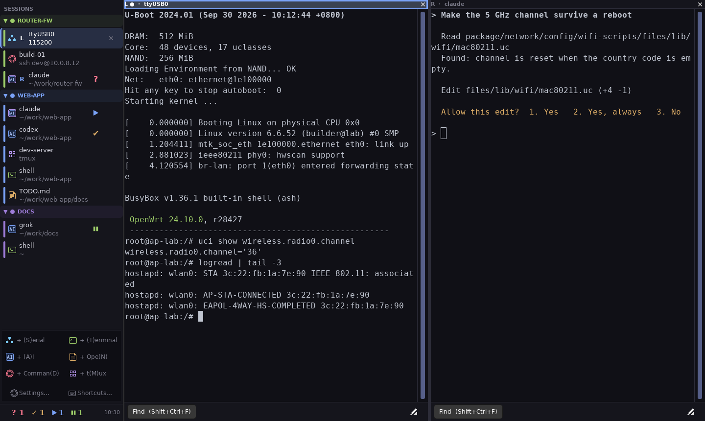

<p align="center">
  
</p>

<h1 align="center">tabit</h1>

<p align="center"><b>Every piece of work becomes a tab you manage.</b></p>

<p align="center">
  <a href="https://github.com/ChrisLi826/tabit/releases/latest"></a>
  <a href="LICENSE"></a>
</p>

tabit is a Linux GTK terminal. Shells, serial consoles, SSH, AI agents, tmux
sessions, notes and files all live in one tab list down the left of one
window. Tabs sit in colour groups, and every AI tab shows its status.

**Remote** puts the same list on your phone or laptop, live, over Tailscale.
You can also type into a tab from there.

Native GTK + VTE. No Electron, no pip. One install script.

<p align="center">
  
</p>

## Every kind of work is a tab

| Your work | Its tab |
|---|---|
| A board on a USB serial port | **+ Serial**: `screen`, `kermit` or `picocom`; or `ssh` / `telnet` to a console server |
| A shell, here or over SSH | **+ Terminal**, or **+ Command** for any command line (`ssh root@192.168.1.1`) |
| An AI agent: Claude, Codex, Grok and more | **+ AI**: in a folder you pick; it can run inside tmux, so it keeps working while tabit is closed |
| A long-running tmux session | **+ tmux**: attach to one or make one |
| A note, a Markdown file, an image or a PDF | **+ Open**: an editor with a Markdown preview; images and PDFs open rendered |

Then every tab works the same way:

- **Colour groups**: one colour per project; collapse what you are not using.
- **Status at a glance**: an AI tab shows ▶ working, ❚❚ idle, ? needs you, ✔ ready,
  ↻ replied with sub-agents still running.
  A popup says when an agent finishes or wants you.
- **Two side by side**: pin any tab to a right pane.
- **Remembered**: the next start brings back the same tabs. tmux-backed agents
  are reattached in the middle of what they were doing.

## Remote: your tabs on your phone

<p align="center">
  
</p>

<p align="center">
  
</p>

Turn it on in **Settings… → Remote**. tabit sets up Tailscale for you, then
serves a page to your own devices only. On a phone, add it to the home screen.

- **See**: every group and tab, and which agents need you, updated live.
- **Type** (a switch, off by default): read a tab's screen and type into it:
  answer an agent, run a command on a shell, or use a serial console.
  Attach a file or a screenshot.
- **Manage**: open, rename, move and close tabs and groups from the page.
- **Read files** (a second switch): tap a path to read the file.

On a laptop browser the page looks like tabit itself. More: [docs/remote.md](docs/remote.md).

## Install

```sh
git clone https://github.com/ChrisLi826/tabit.git
cd tabit
./install.sh      # apt deps + ~/.local/bin/tabit + app menu entry
~/.local/bin/tabit &
```

To remove: `./install.sh --uninstall`

In-app **Check for updates** reinstalls the latest release (git pull when a
checkout exists; otherwise downloads the release tarball). May ask for your
sudo password for apt.

## Requirements

- Linux with GTK3 + VTE + GtkSourceView 4 (X11 or Wayland)
- WebKit2 + `python3-markdown` for note Markdown preview
- libnotify (`gir1.2-notify-0.7`) for AI status notifications
- `screen` and `picocom` for serial sessions
- Tailscale for Remote (tabit can install it for you)
- Tested on Ubuntu / Xubuntu

`install.sh` installs these from apt. Tailscale is not part of it: tabit offers
to install it when you turn Remote on.

## More

- [Using tabit](docs/usage.md): every button, key and shortcut; restore, tmux, two panes
- [AI agent status](docs/ai-status.md): the popup and the count row
- [Remote](docs/remote.md): setup, the three switches, what the page can do
- [Telegram](docs/telegram.md): pushes to your phone, and tasks sent back to an agent
- [Releasing](docs/releasing.md): versions and codenames (for maintainers)

## Where tabit fits

If you already use **tmux** or **Tilix**, keep them for session persistence
inside a host and for many-way tiling. tabit is a **session dock**: many
independent VTE terminals (and notes) as one tab list, with any two of them
side by side when you need it — especially when you juggle **serial
boards**, **SSH consoles**, and **several AI CLIs** and want at-a-glance
status without tiling windows by hand. With Remote, that same tab list goes
with you.

## Roadmap

- Saved session profiles (named serial/ssh setups)

## License

MIT
