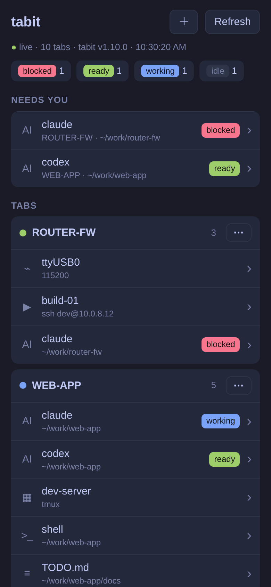
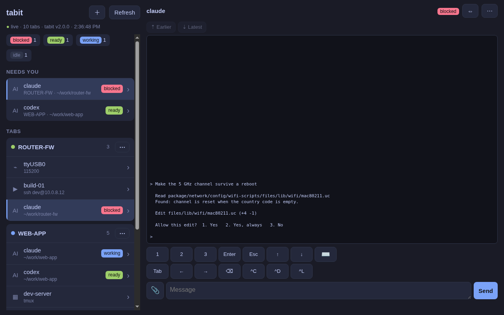

# Remote

Remote shows your tabit on your phone or another computer: every group and
tab, with live AI status. With the extra switches on, you can also type into
tabs, manage them and read files. Back to the [README](../README.md).

  

  

## How it reaches you

tabit serves the page through **Tailscale Serve**, so it travels only inside
your own tailnet. Only your own Tailscale login gets in; other people on a
shared tailnet get 403.

Open `https://<this-host>.<tailnet>.ts.net/` on the other device. On a phone,
**Share → Add to Home Screen** makes it an app. In Chrome or Edge, **Install**
in the address bar opens it in its own window. The other device needs the
Tailscale app, signed in to the same account.

## Turning it on

**Settings… → Remote.** Turning it on gets Tailscale ready on this computer
first. It asks once before it does anything, then:

1. installs Tailscale (the official script),
2. starts the service,
3. lets your user run Tailscale without sudo (`--operator=$USER`),
4. opens the Tailscale login page in your browser,
5. opens the page that turns on Serve for your tailnet.

Steps that need root ask for your password, and each runs at most once.
Saying No turns Remote off again. Tailscale serves a unix socket only for a
user who may also use sudo.

## The three switches

**Remote** (the first switch) — a page you can only look at: groups, tabs,
AI status, live updates.

**Allow typing into tabs** (off by default) — the page can open any terminal
tab (shell, serial, tmux, AI) and type into it. For a shell or a serial
console, that is a remote shell from your phone.

- See the screen: colours for tmux-backed tabs; **Earlier**, or scrolling up
  to the top, loads more history. A− / A+ set the text size.
- Type: a text box; a ⌨ keyboard mode that sends each key straight in (and
  input-method words when you pick them); and keys: 1–3, Enter, Esc, Tab,
  arrows, ⌫, Ctrl+C/D/L.
- Attach files: 📎 on a phone, or drag and drop / paste a screenshot on a
  computer. They are saved to `~/.local/share/tabit/uploads/<date>/` (never
  overwritten, at most 25 MB), and the path goes into the text box.
- Manage tabs: ＋ opens a Terminal, an AI (from tabit's AI list, in tmux, a
  fresh session) or a Command, in a folder and group you choose. A tab's ⋯
  renames it, sets its group, moves it or closes it. Closing an AI tab stops
  its agent and its tmux session, after you confirm. The last tab cannot be
  closed from the page, because that would quit tabit.
- Manage groups: a group's ⋯ renames it, changes its colour, collapses or
  expands it in tabit, moves it or removes it. The ⋯ on **No group** turns
  those tabs into a new group with a name and a colour.
- The desktop keeps showing the tab it was showing.

**Allow opening files** — tap a path or a note tab to read the file. Only
files under your home and `/tmp`: text, and png, jpg, gif, webp and svg images,
up to 2 MB. Key and password files are never shown.

## On a laptop or desktop browser

The page looks like tabit itself: tabs on the left (the open one marked), and
the tab or file on the right. Drag the gap between them to set the list
width; double-click it to reset. 🔔 shows a browser notice when an AI tab goes
from working to ready or blocked.
